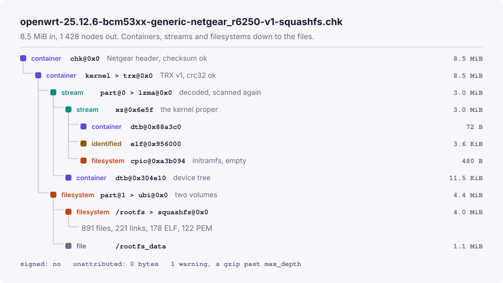

# firmcarve

Point it at a firmware image in memory and get back a tree of every region it could prove:
the containers, what they hold, what that decompresses to, and the files inside.

<picture>
  <source media="(prefers-color-scheme: dark)" srcset="docs/tree-dark.svg">
  
</picture>

That is the OpenWrt 25.12.6 image for the Netgear R6250, as printed by
[`examples/firmcarve.c`](examples/firmcarve.c) and redrawn: 1 428 nodes, every byte accounted for.

A region only enters the tree when its format validates it. A header has to parse, a filesystem
has to mount, a stream has to decode; a container with a bad checksum is kept, marked damaged,
and not descended into. Whatever comes out of a region is scanned again, so a kernel inside an
lzma loader inside a TRX inside a vendor header is found the same way as one lying at offset 0.

## What it recognises

- **Containers**: everything [firmhead](https://github.com/augustoflorentino/firmhead) reads
  (uImage, FIT, TRX, Netgear CHK, TP-Link, Xiaomi HDR1, Reolink PAK, Android boot, device
  trees and more).
- **Flash filesystems**: JFFS2, cramfs, UBI and UBIFS through
  [flashfs](https://github.com/augustoflorentino/flashfs); SquashFS 4.0 through a built-in reader.
- **Streams**: gzip, xz, lzma, zstd, bzip2, lz4 and lzop.
- **Archives**: cpio (newc), tar (ustar) and zip.
- **Identified, not unpacked**: ELF and PEM regions, sized from their own headers.

At the top level it also measures what nobody claimed. Bytes that are not padding count as
unattributed, and a 64 KiB stretch above 7.9 bits/byte with no format becomes an `unknown` node
with an `FWT-IMG-001` warning. `fwc_signed` folds the signature facts of every container into
`no`, `yes`, or `unknown` when part of the image was not understood.

## Build

```sh
cmake -S . -B build -DFIRMCARVE_BUILD_EXAMPLES=ON
cmake --build build
./build/firmcarve image.bin
```

firmhead (3.x) and flashfs come from an installed copy when CMake finds one, otherwise from
sibling directories (`FIRMCARVE_DEPS_DIR`, `..` by default). Every codec is optional: zlib,
liblzma, libzstd, bzip2, lz4 and lzo2 are used when present, and a stream whose codec is missing
gives a `missing-extra` warning instead of a node. `fwc_features()` says which ones made it in.

## Use

```c
fwc_options_t options;
fwc_tree_t *tree;

fwc_options_init(&options);
if (fwc_carve(buf, len, &options, &tree) == FWC_OK) {
    for (size_t i = 0; i < fwc_node_count(tree); i++) {
        const fwc_node_t *n = fwc_node_get(tree, i);
        printf("%s %s\n", fwc_kind_name(n->kind), n->path);
    }
    fwc_tree_destroy(tree);
}
```

Each node has its kind, format, offset and size inside its parent, depth, a `damaged` flag and a
full path such as `chk@0x0 > kernel > trx@0x0 > part@0 > lzma@0x0`. `options.on_node` sees each
node as it is found, with its bytes: decompressed for streams, the target for links.

## Extracting

Set `options.extract_dir` to an existing directory and the tree is written there. A node with
bytes becomes a file at its own path, its children go in `<name>.d/`, and filesystem entries keep
their directories. The input is assumed hostile:

- names are cleaned for every platform: no `..`, no absolute paths, no reserved Windows names;
- a name that already exists gets `~<index>`, and nothing is written through a symlink;
- links are created last, rewritten to stay inside their filesystem; one that would leave it is
  refused with an `extract-refused` warning.

## Limits

Depth 8, 2 GiB in total, 256 MiB per entry, 200 000 entries and 50 000 candidates per format
family, all in `fwc_options_t`. Reaching one adds a `budget-exceeded` or `probe-limit` warning and
the scan carries on with the rest of the image.

## License

MIT, see [LICENSE](LICENSE). Security reports: [SECURITY.md](SECURITY.md).
